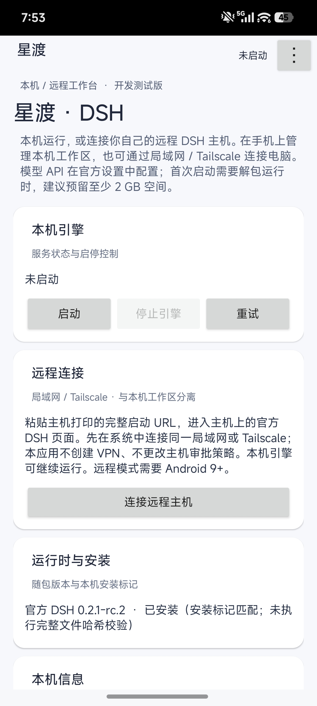
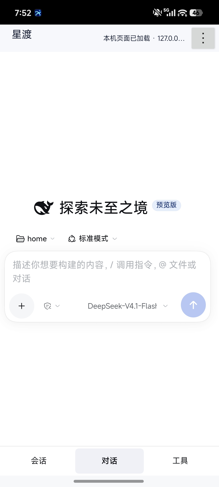
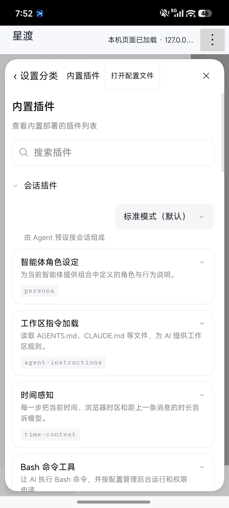
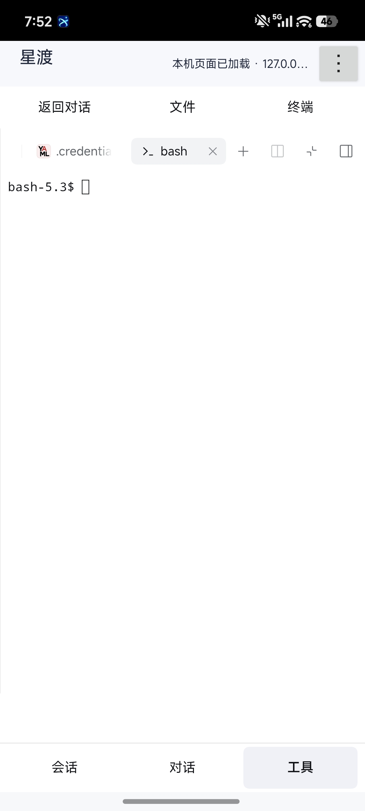

# 星渡 · DSH Android


**本机运行，也能渡向远程。** 星渡是基于 DeepSeek Harness（DSH）的非官方 Android 工作台：在手机上运行本机引擎、使用对话与工具界面，也提供连接自有远程 DSH 主机的入口。

> **当前版本：`0.1.9-dev` · Debug 开发预览 · 非稳定版。** 不是 DeepSeek 官方安卓客户端。**用户已完成真机验收并逐项确认：局域网远程连通、SAF 实操、覆盖安装、中文输入法、真实 API 会话未发现问题**；仪器测试已首次在真机全量执行（26 项中 22 项通过，其余 4 项为环境/测试框架因素，见[验证状态](#验证状态)）。Tailscale 连通与屏幕隐私完整系统行为仍无单独验收结论。请先备份数据，仅用非敏感文件试用。

[下载开发预览](https://github.com/Thy985/xingdu-dsh-android/releases/tag/v0.1.9-dev-preview) · [真机截图](#真机界面) · [快速开始](#快速开始) · [验证状态](#验证状态) · [本地构建](#本地构建) · [路线图](ROADMAP.md) · [变更日志](CHANGELOG.md)

## 能做什么

| 能力 | 当前实现与边界 |
| --- | --- |
| 本机工作台 | 随包提供 Android Bionic Node.js 24.18.0、DSH `0.2.1-rc.2`、Bash、ripgrep、CA 证书、文件锁及 PTY 助手；前台服务在手机启动 `dsh web`，无需电脑、Termux 或 Root。 |
| 手机对话界面 | 底部「会话 / 对话 / 工具」导航、会话抽屉、空会话居中输入、窄屏设置分类与单列详情；保留官方编辑器、草稿和发送逻辑。 |
| 内置插件与工具 | 使用官方内置插件页，以及工作区的文件与终端面板；不绕过审批、不自动安装或启停插件，也不提供额外的无约束 shell。 |
| 手机文件传输 | 通过 Android 系统文件选择器导入文件副本、导入文件夹快照、单文件另存为，以及向原授权文件夹导出新副本；不是实时挂载或双向同步。 |
| 远程入口 | 可粘贴自有主机的完整 DSH 启动 URL；网络需先由系统建立，应用不创建 VPN、不配置远端 DSH，也不开放主机公网端口。局域网连通已经用户真机验收；Tailscale 连通尚未验证。 |
| 截图与录屏控制 | `0.1.8-dev` 默认设置窗口保护；明确确认风险后可放开，本机与远程共用选择。核心行为（默认保护、启停切换、跨进程同步）已经真机仪器测试验证；系统级截图、录屏和最近任务实操仍需按设备验证。 |

**本机引擎不等于离线模型。** 应用没有附带大模型，模型请求仍需在 DSH 设置中配置自己的 API，可能产生对应服务费用；导入内容也可能被发送到所配置的模型服务。

## 真机界面

以下四张截图由用户提供并授权公开，展示本机使用界面，不作为模型请求成功、终端命令执行成功或远程连接成功的证明。仅收录已确认可公开的图片，不包含凭证内容截图。

<table>
  <tr>
    <td align="center"><strong>首页 · 本机与远程入口</strong></td>
    <td align="center"><strong>对话 · 手机输入布局</strong></td>
  </tr>
  <tr>
    <td></td>
    <td></td>
  </tr>
  <tr>
    <td align="center"><strong>设置 · 内置插件</strong></td>
    <td align="center"><strong>工具 · 文件与终端入口</strong></td>
  </tr>
  <tr>
    <td></td>
    <td></td>
  </tr>
</table>

## 下载与设备要求

从 [v0.1.9-dev-preview 发布页](https://github.com/Thy985/xingdu-dsh-android/releases/tag/v0.1.9-dev-preview) 下载：

| 附件 | 用途 |
| --- | --- |
| `Xingdu-DSH-0.1.9-dev-arm64.apk` | ARM64 Debug 侧载安装包，不是正式签名的稳定发行版。 |
| `Xingdu-DSH-0.1.9-dev-source.zip` | 包含完整内嵌运行时的源码工程，用于本地构建。 |
| `SHA256SUMS.txt` | 上述两个附件的 SHA-256 校验值。 |

- **本机模式：** 支持 `arm64-v8a` 的 Android 8.0+ 设备。
- **远程模式：** Android 9+，用于独立 WebView 数据目录；Android 8 仅保留本机模式。
- **存储空间：** 首次启动需校验并解包约 825 MB 运行时，建议至少预留 **2 GB**，供安装包、运行时、升级暂存和工作区使用。
- **版本信息：** 应用 ID `io.github.zhanxing.dshandroid`，versionCode `10`，当前 `targetSdk 28`；这是侧载兼容性折中，不是现代应用商店发布方案（升级路径见[路线图](ROADMAP.md)）。

将两个附件和校验文件下载到同一目录后执行：

```sh
sha256sum -c SHA256SUMS.txt
```

**Git 仓库与 GitHub 自动生成的 Source code 归档不包含约 211 MiB 的 `runtime.zip`。** 需要完整可构建工程时，请选择本项目明确上传的 `Xingdu-DSH-0.1.9-dev-source.zip`，不要与自动源码归档混淆。

## 快速开始

### 本机模式

1. 校验并安装 ARM64 APK，确认有足够存储空间。
2. 在首页「本机引擎」点击「启动」，按提示完成首次风险确认，等待运行时安装和本机页面加载。
3. 在 DSH 设置中配置自己的模型 API，再选择工作区和会话。页面显示已加载，仅表示本机主页面加载完成，不代表模型服务或全部工具已经可用。
4. 通过底部「会话 / 对话 / 工具」切换页面。内置插件入口在「会话栏 → 账号菜单 → 设置 → 内置插件」；文件与终端使用官方工具面板。无会话时，工具入口会给出工作区/会话指引。
5. 启停、重试、脱敏日志和只读诊断可从首页或顶部 `⋮` 菜单访问；「关闭手机布局」可恢复官方页面呈现，不重载页面或主动清空草稿。

本机 WebView 仅导航到 `127.0.0.1:3080`。默认工作区为 App 私有 `files/workspaces/default`，配置与会话位于 `home/.dsh`。卸载、清除数据前请自行备份；不要把唯一的重要数据副本放在开发版里。

### 远程模式（局域网已经用户真机验收；Tailscale 未验证）

1. 在自有电脑上按官方 DSH 要求启动服务，确保监听地址可达、可信主机配置正确。
2. 先在 Android 系统中连入同一局域网，或自行建立 Tailscale / VPN 网络。
3. 在首页「连接远程主机」或顶部菜单粘贴主机打印的**完整启动 URL**，按应用 URL 策略处理；不接受包含用户名/密码字段（userinfo）的 URL。启动地址仍可能携带认证信息，不要公开分享。`127.0.0.1` 在手机上仍指手机自身，不是电脑。

远程使用独立 `:remote` 进程及 WebView `remote` 数据目录，与本机配置、工作区分开；切换远程不停止本机引擎，断开也不停止远端任务。关闭远程会话后尝试清理其 Cookie、网页存储和缓存，不持久化启动凭证；刷新或重建可能需要重新粘贴完整认证地址。

优先使用 HTTPS，证书错误不放行。私网 HTTP 需要勾选允许并再次确认，仅接受应用策略支持的私有 IPv4、Tailscale `100.64.0.0/10`、本地 IPv6 和明确本地域名。域名后缀不证明路由安全，应用也不验证隧道状态。远程文件选择仅服务于官方页面发起的上传，**远程下载暂未实现**；「手机文件」只操作本机默认工作区，不提供跨设备同步。

## 手机文件：复制、快照与导出

入口为首页「手机文件」，或本机页面顶部 `⋮ → 手机文件（导入 / 导出）`，无需启动引擎即可传输。

| 操作 | 实际行为 |
| --- | --- |
| 导入手机文件 | 系统选择一个或多个文件，整批成功后复制到默认工作区新建的 `import-<UUID>/`，不修改手机原件。 |
| 导入手机文件夹 | 复制授权目录本次的内容和层级，保留空目录；在提供器允许时保存可持久化授权及来源映射。不是挂载，不把 `content://` 当普通 Node / Bash 路径。 |
| 导出默认工作区文件 | 选择单个普通文件，通过系统「另存为」保存；目标重名及覆盖确认由系统文件提供器处理，请核对目标。 |
| 导出回原文件夹 | 对有有效来源记录和写权限的文件夹，在原授权树内创建 **`xingdu-export-*` 新子目录**，保存当前本机副本；不覆盖或删除原文件。 |

旧版快照或单个散文件没有文件夹来源映射；需要重新导入文件夹后使用「导出回原文件夹」。授权被撤销、只读或映射失效时会拒绝并提示重新选择，不绕过系统限制。

单文件上限 **128 MiB**，每批 **256 MiB / 1000 文件 / 2000 条目 / 16 层**；导出浏览器每目录最多扫描 200 条，超限会提示。传输拒绝越界、符号链接、异常名称和重复/循环条目，不申请 Root 或全盘访问。

导出前请停止修改工作区：这不是引擎级一致快照。取消、中断或提供器失败可能留下不完整的系统目标文件或导出子目录；强杀也可能留下 App 私有暂存目录。取消不是回滚，不自动删除用户原件。**系统选择器与回原文件夹导出已由用户真机人工验收（2026-10-24 整体报告未发现问题）；持久授权撤销与限额触发等边界未逐项确认。**

## 截图、录屏与隐私

`0.1.8-dev` 在本机与远程 Activity 显示内容前默认设置 `FLAG_SECURE`；新装或清除数据后默认保护。

- **本机入口：** 顶部 `⋮ → 截图与录屏`，或首页「安全快捷入口 → 截图与录屏」。
- **远程入口：** 连接页「截图与录屏」，或已连接页面顶部「隐私」。
- **开启：** 打开「允许截图与录屏」后，还需点击「理解风险并开启」。本机与远程共用选择，应用重启后保留。
- **关闭：** 无需二次确认，恢复保护，不重载 WebView、不停止引擎或清理会话。Provider 不可用、选择缺失或保存失败时不主动放开保护。

允许后，截图、录屏、投屏和最近任务预览可能暴露会话、文件、启动 URL 或密钥。最近任务预览没有独立开关；结束展示后建议关闭。恢复保护不会删除已有截图、录像或系统预览，实际行为依赖系统和厂商，不能保证对 Root、同 UID 插件或恶意系统的隔离。

屏幕隐私仪器测试已首次在真机执行（华为 DBR-W00，Android 12）：9 项中 7 项通过，含默认保护、开启/关闭切换与 **`:remote` 进程跨进程同步**；2 项因 androidx 测试框架在 EMUI 平板上的生命周期机制限制未获验证（详见[仪器测试记录](tests/validation/0.1.9/instrumented-huawei-dbr-w00.md)）。系统级截图、录屏与最近任务实操仍未执行，用户截图不构成相应证据。

## 验证状态

**用户真机验收：已完成。** 2026-10-24 用户逐项确认并反馈未发现问题：**局域网远程连通、SAF 实操、覆盖安装升级、中文输入法、真实 API 会话**。此处按项目惯例记录用户人工验收，不折算为逐项自动化验证；更早的整体验收反馈与四张授权截图（首页、对话、内置插件、工具/终端）仍然有效。

| 证据 | 已确认的范围 | 不能据此推断 |
| --- | --- | --- |
| 用户真机人工验收（2026-10-24） | 局域网远程连通、SAF 系统选择器与导出实操、覆盖安装升级、中文 IME、配置自有 API 后的真实会话：用户报告未发现问题。 | 边界场景（授权撤销、限额触发、断线恢复）、Tailscale，以及任何自动化断言。 |
| 仪器测试真机全量执行（华为 DBR-W00，Android 12） | 26 项全部执行，22 项通过：`SafTransferTest` 10/10；`ScreenPrivacyTest` 7/9（默认保护、启停切换、`provider` 私有性、多控制器同步、**`:remote` 跨进程 FLAG_SECURE 同步**）；`MobileLayoutTest` 5/7（含旋转保持与首页状态控制）。 | 4 项失败均已定性为环境/测试框架因素：2 项 androidx 生命周期机制在 EMUI 不可用、真机软键盘不触发窗口缩放、华为 WebView 错误呈现差异（待查）——对应应用行为仍记"未验证"，详见[仪器测试记录](tests/validation/0.1.9/instrumented-huawei-dbr-w00.md)。 |
| 构建与自动化记录 | Debug 应用与 AndroidTest APK 构建成功；JVM 单测 58 项由 Linux CI 在发布提交上执行（本机 Windows 57/58，差异为依赖 POSIX FIFO 的既有用例）；移动适配回归 2 组通过；插件契约检查通过；APK v2 签名验证通过。 | 历史记录不因新版本自动延续；各版本以自身验证记录为准。 |

**仍无逐项验收结论：** Tailscale 连通，系统截图/录屏/最近任务完整行为（含两态切换实操），SAF 授权撤销与限额边界，较大系统字号，后台恢复，前台服务在厂商后台策略下的存活，真机软键盘窗口缩放（`adjustResize`），华为 WebView 主文档错误呈现。以上不据此推断已通过，也不影响用户已完成项目的验收记录。

当前证据见 [0.1.9 验证摘要](tests/validation/0.1.9/summary.json)、[验证清单](tests/validation/0.1.9/device-verification-checklist.md)与[仪器测试记录](tests/validation/0.1.9/instrumented-huawei-dbr-w00.md)；旧版本记录保留在 [tests/validation/](tests/validation/) 和 [RELEASE_NOTES.md](RELEASE_NOTES.md)。这些文件描述各自构建或发布时的状态，不把历史未执行测试改记为通过。

## 安全与已知限制

- **权限与执行：** 保留官方默认 `workspace-write` 和审批策略，不自动开启 `danger-full-access`。Android 缺少桌面 Landlock 等隔离能力，受限工具可能报告 `SANDBOX_UNAVAILABLE`；App 私有目录不等于插件之间的安全沙箱。
- **页面与网络：** WebView 禁止文件 URL、任意 content URL、混合内容及 JavaScript 原生桥。远程主页面和被拦截的 HTTP(S) 资源要求同源；为支持私网 HTTP，平台明文配置放开、由应用策略限制。应用层拦截不是完整网络沙箱，不全面覆盖 WebSocket、service worker 或同 UID 命令的网络行为，不绕过 TLS、登录或审批。
- **日志与凭证：** 本机认证地址通过同进程 Binder 传递，日志仅在内存保留并尝试脱敏；任意插件输出不保证完整脱敏。不要上传原始日志、启动 URL、模型密钥、凭证文件或含敏感内容的截图。
- **安装与数据：** 运行时经散列校验后暂存并替换；首页安装标记匹配不等于每次都重新校验全部解包文件。部分硬链接发布改为 `COPYFILE_EXCL` 复制，复制不是原子发布，断电/强杀恢复没有完整保证。
- **进程与兼容：** 停止引擎会终止 Node 主进程，但脱离的插件子进程/整棵进程树回收无保证。相机、语音、附件、第三方插件与原生扩展未逐项移植；不承诺全部桌面能力。不同 Android、WebView 和厂商后台策略仍需测试。

## 本地构建

需要 **JDK 17+、Android SDK 35、Python 3**，并允许 Gradle wrapper 访问依赖源。配置本机 `local.properties` 的 `sdk.dir`。

完整发布源码 ZIP 已带运行时；若使用 Git checkout，先从校验通过的源码 ZIP 恢复缺失资产（仓库根目录执行，按实际位置调整 ZIP 路径）：

```sh
unzip -p ../Xingdu-DSH-0.1.9-dev-source.zip \
  dsh-android-native/app/src/main/assets/runtime.zip \
  > app/src/main/assets/runtime.zip
python3 scripts/runtime/verify-runtime.py app/src/main/assets/runtime.zip --arch aarch64
./gradlew testDebugUnitTest lintDebug assembleDebug assembleDebugAndroidTest
```

应用输出：`app/build/outputs/apk/debug/app-debug.apk`。Gradle 会校验运行时缺失和 SHA-256，不允许把缺少本机引擎的空壳当产品构建；手机插件资产由 `prepareMobileShell` 自动生成。

重新制作运行时需 Linux、Node/npm、Android NDK `27.2.12479018`、dpkg-deb、apt、zip 和 Python，入口为 `scripts/runtime/build-runtime.sh <输出zip> aarch64`。解析锁见 [dsh-runtime-resolved-lock.json](scripts/runtime/dsh-runtime-resolved-lock.json)，它不是完整可重放的顶层 npm lock，重新解析依赖后必须重新验收。

### 开发回归入口

```sh
# 独立手机插件契约，无需用户模型配置
node tests/mobile-shell-contract.cjs

# 有专用 Android 测试设备时执行仪器测试
./gradlew connectedDebugAndroidTest

# 只执行屏幕隐私测试
./gradlew :app:connectedDebugAndroidTest \
  -Pandroid.testInstrumentationRunnerArguments.class=io.github.zhanxing.dshandroid.ScreenPrivacyTest
```

页面回归入口为 `PLAYWRIGHT_MODULE=/path/to/playwright python3 scripts/test-mobile-ui.py`，需预备临时官方 DSH `0.2.1-rc.2` 实例（`runtime-build/host-preview` 或 `DSH_HOST_BIN`），可在末尾指定单组；相关套件位于 `tests/mobile-*.cjs`。使用隔离临时配置，不使用真实模型密钥，不发送模型请求或终端命令。主机 Chromium 结果不能代替 Android WebView / IME 验收。

Android 运行时组件检查脚本为 `tests/runtime-smoke.mjs`，必须在目标 Android 环境运行。仪器测试 fixture 也只应在专用测试设备上运行，不要操作承载重要数据或真实引擎的设备。

## 项目与许可

“星渡”寓意从手机本机工作台渡向自己的电脑。图标源文件位于 `branding/xingdu-icon.png`，可用 `python3 scripts/prepare-branding.py` 重新生成 Android 资源。名称与图标不改变应用 ID；实际覆盖升级仍需真机检查。

手机导航插件位于 `mobile-shell/`，使用官方公开的 `shell.overlay` / `settings.action` 插槽和布局服务，沿用同一 React 与官方组件，不复制编辑器、不搬动现有 DOM，也不是完整根布局替换。宽屏或关闭手机适配时回退官方呈现。

上游来源及版本见 [UPSTREAM.json](UPSTREAM.json)；项目许可见 [LICENSE](LICENSE)，运行时与依赖许可见 [第三方声明](scripts/runtime/THIRD_PARTY_NOTICES.md) 及 [third_party/runtime/](third_party/runtime/)。本次文档与截图更新不更换上游、运行时或应用功能。

后续版本计划（验证补全、发布架构迁移、功能补齐与正式发布）见 [ROADMAP.md](ROADMAP.md)，逐版本历史见 [CHANGELOG.md](CHANGELOG.md)。
